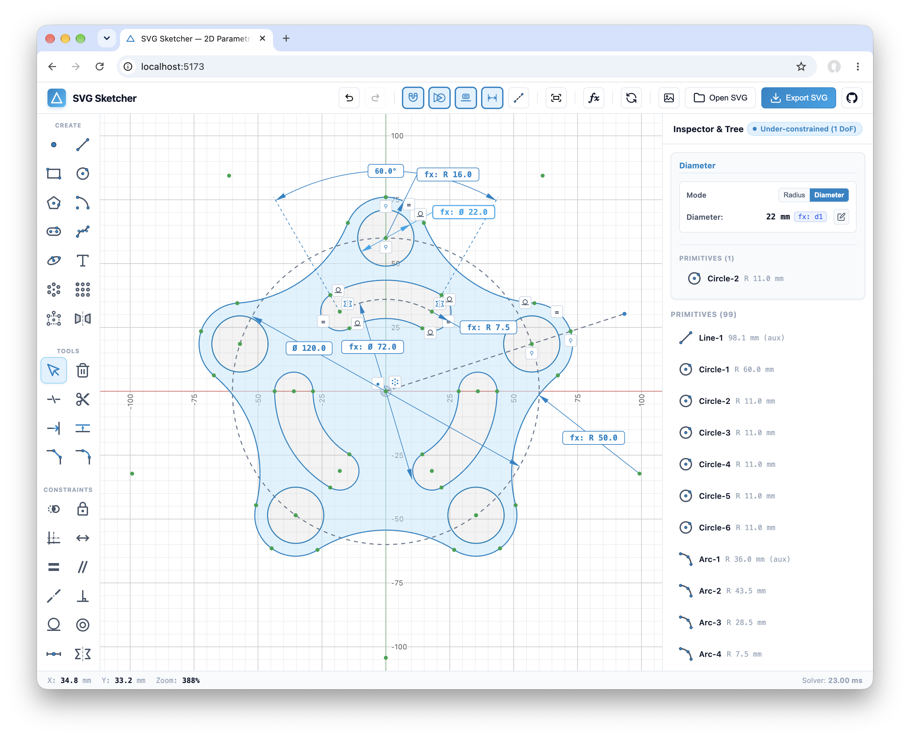

# SVG Sketcher

SVG Sketcher is a browser-based 2D CAD editor for drawings that stay editable through dimensions, geometric constraints, and named parameters. Its geometric solver updates the sketch as you drag geometry or change a dimension, and SVG exports can be reopened for further editing.

## Live Demo

Try it online: **[https://damir3.github.io/SVGSketcher/](https://damir3.github.io/SVGSketcher/)**



## Features

- **Drawing.** Create points, lines, regular polygons, rectangles (including rounded rectangles), circles, arcs, ellipses, elliptical arcs, and straight or curved slots. Draw splines through fit points or with control points, and add text in a box or along a path.
- **Geometry editing.** Trim, extend, or split curves, round corners with fillets, bevel them with chamfers, and offset connected chains on one or both sides. Mirror geometry or repeat it with circular and rectangular patterns that support suppressing individual copies.
- **Geometric constraints.** Fix points, make entities coincident, or constrain a point to an object or midpoint. Apply horizontal, vertical, parallel, perpendicular, collinear, tangent, concentric, symmetric, equal-length, and equal-radius relationships. Use the origin and axes as references.
- **Dimensions and parameters.** Set distances, angles, radii, and diameters. Drive dimensions with expressions such as `width / 2` and change related dimensions together by editing a named parameter. Use the inspector to edit properties and check the sketch's remaining degrees of freedom.
- **Sketching workspace.** Use an adaptive grid, snap to geometry, and draw construction geometry. Select and drag entities or use directional box selection. Pan, zoom, fit the view to the sketch or selection, and undo or redo edits. Toggle closed-region fills, constraint badges, and dimension labels independently.
- **SVG import and export.** Open or drop an SVG onto the canvas. Import supported SVG shapes and paths as sketch geometry. SVG Sketcher exports include editable geometry, constraints, parameters, and the saved view in metadata alongside the visible SVG artwork.

## Development

Start the local development server:

```bash
npm run dev
```

Open [http://localhost:5173](http://localhost:5173) in your browser.

Build for production:

```bash
npm run build
```

The editor loads the Rust/WebAssembly geometry backend by default for intersections, constraint solving, spline calculations and closed-region construction, with a TypeScript fallback. See [Rust kernel setup and verification](./docs/rust-kernel.md).

Reproducible large scenes and TypeScript/WASM measurements are available in the [performance benchmark guide](./benchmarks/README.md).

## License

This project is licensed under the [Apache License 2.0](./LICENSE).
